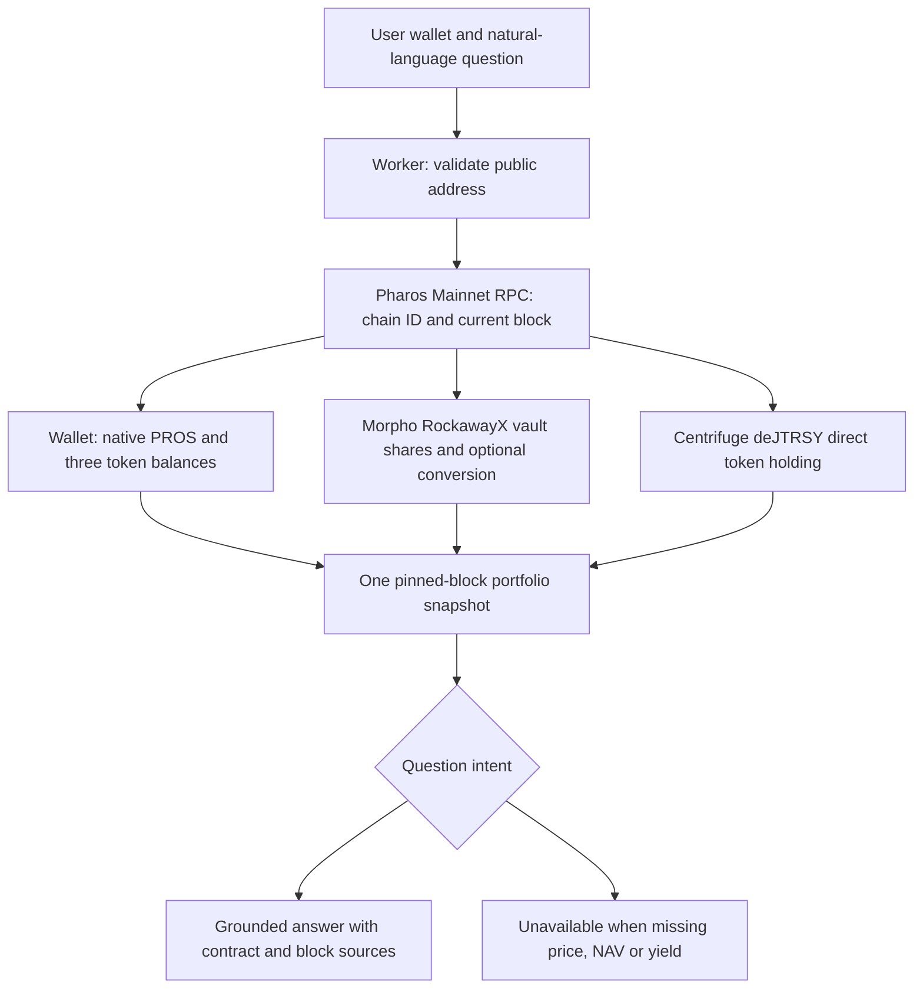

# Portfolio Assistant — Pharos Agent Arena (Hard, 200 points)

[Live website](https://portfolio-assistant.trantanlong2411.workers.dev/) · [Source](https://github.com/trantanlong2411-droid/Portfolio-Assistant)

A read-only natural-language assistant for public wallets on Pharos Pacific Mainnet (chain 1672). It reads wallet token balances and two independently identified protocol contracts in a **single pinned-block snapshot**, then answers questions with contract address, method and block for every verified number. Missing fields are shown as unavailable, never silently converted to zero.

## Verified mainnet execution proof

[Permanent public proof](./proof/README.md) and [successful live GitHub Actions run](https://github.com/trantanlong2411-droid/Portfolio-Assistant/actions/runs/41605763153) confirm both protocol contract reads at block 21999193, all wallet token reads, ten question types and eight automated tests.

## User-exported proof from 3 November 2026

- [Review the browser-exported snapshot and question-specific result](./proof/USER-PROOF.md).
- [Inspect the original exported JSON](./proof/user-portfolio-export-2026-11-03.json), block 22004613, with actual zero holdings and source addresses.
- The CI verification script independently replays the reported `biggest position` answer, checks the source contracts and pinned block, and exercises 10 other language patterns from the exported snapshot.
- Do not claim this single JSON proves ten independent HTTP calls: it is one exported query, supplemented by earlier deployed GitHub Actions live tests.

## Coverage and on-chain sources

| Source | Contract | Function |
| --- | --- | --- |
| Native wallet PROS | Input wallet address | `eth_getBalance(address, pinnedBlock)` |
| Wallet USDC | `0xc879c018db60520f4355c26ed1a6d572cdac1815` | `balanceOf(address)`, `decimals()` |
| Wallet WPROS | `0x52c48d4213107b20bc583832b0d951fb9ca8f0b0` | `balanceOf(address)`, `decimals()` |
| Wallet WETH | `0x1f4b7011Ee3d53969bb67F59428a9ec0477856E9` | `balanceOf(address)`, `decimals()` |
| Morpho / RockawayX V2 vault | `0x047cd0a91e9b92ed979189a6c8a120bf280f02e5` | `balanceOf(wallet)`, optional `asset()`, `convertToAssets(shares)` |
| Centrifuge deJTRSY token holding | `0x8de0f3295b9e42b29e7617bada7c603277420451` | `balanceOf(wallet)`, `decimals()` |

Centrifuge's official deployment registry also documents a Pharos USDC **deJTRSY vault** at `0xc427d079bda79a703749da3a7b22b121b6bea603`. This assistant currently reports the wallet's *direct deJTRSY position token balance*, which is **not** proof of an active deposit in that vault, of withdrawal rights, of USD NAV or of the user's entire Centrifuge exposure.

The Morpho vault address is cited from the DefiLlama curator adapter for Pharos and on-chain code is checked before balance reads. A Morpho vault share balance can have a different unit from the underlying USDC; the app invokes `convertToAssets` when the contract supports it and marks conversion unavailable otherwise. It does not count vault shares as direct USDC.

## Why numbers are grounded

The Worker queries `eth_chainId`, gets an actual latest block, and pins every contract read to that same block. For each number, the JSON includes:

- `chainId`, `block`
- `contract`
- `method` (`balanceOf`, `decimals`, `eth_getBalance` or `convertToAssets`)
- Quantity and unit, or an explicit `available: false` with error
- A link to the Pharos mainnet contract explorer

Only an allowlisted set of JSON-RPC *read methods* is accepted. There is no `eth_sendRawTransaction`, signing key, transfer or wallet authorization flow.

## At least five natural-language questions

The assistant recognizes and answers (from the same live snapshot):

1. “Show my portfolio” — overview and verified holdings.
2. “Where is my USDC?” — direct wallet USDC and separate verified Morpho underlying exposure if available.
3. “What is my Morpho position?” — vault shares and optional underlying units.
4. “Do I hold Centrifuge deJTRSY?” — direct token position only, with caveats.
5. “How much native PROS do I have?” — PROS and wrapped PROS separately.
6. “How much WETH / WPROS?” — wallet token queries.
7. “Show sources and block number” — provenance of all successful reads.
8. “What am I earning / my APY?” — explicitly **unknown** unless a reliable yield or history source exists.
9. “What is my biggest position?” — explicitly **unknown by USD**, because share counts and tokens can't be compared without verified prices.

Questions about earnings and biggest positions are answered **honestly**, not with invented APYs, APRs, USD values or cost bases. This is a deterministic language-intent parser, not a hosted LLM and it does not pretend otherwise.

## One flow



## Reviewer walkthrough

1. Open the [website](https://portfolio-assistant.trantanlong2411.workers.dev/).
2. Enter any public Pharos Mainnet wallet, or use the prefilled address. A zero balance is a legitimate real result, not a simulated success.
3. Click **Read positions and answer**, then try the question suggestion buttons for wallet balances, USDC, Morpho, Centrifuge, earnings, biggest position and source references.
4. Open **Full snapshot, methods, contracts and block** to check that figures share one block.
5. Click **Export latest JSON evidence**. Public GitHub Actions independently validates the live deployed Worker and 10 question types.
6. Check the integration CI artifact `pharos-portfolio-assistant-live-proof` for reproducible raw live RPC data.

## Task mapping

| Arena requirement | Implementation |
| --- | --- |
| Two protocols/vaults + wallet token balances | Morpho RockawayX vault shares + Centrifuge deJTRSY token holdings; USDC, WPROS, WETH and native PROS. Unreadable protocols are flagged. |
| Five question types | Nine+ intents with grounded responses and unknown when appropriate; live CI evaluates ten representative questions. |
| Contract and block for each number | Every numerical fact returned in `answer.facts` has a `source` with contract, block and ABI method. |
| Clear unknown rather than guessing | No APY, portfolio USD valuation, or implied vault deposit from a fund token balance. Missing RPC/ABI reads are surfaced individually. |
| Read-only | RPC method allowlist excludes transactions, signing and debug/trace calls. |

## Limits and honest interpretation

This is a scoped *portfolio position reader*, not an exhaustive DeFi position indexer. In particular, tokenized fund holdings and an active vault position may differ. Yield/earnings require historical cash flows and reliable share-price or reward data. An instantaneous balance cannot tell what an investor earned. Largest-by-USD requires trustworthy asset prices and NAV; the assistant refuses to rank unlike asset counts.

The public sample address may have zero positions. The built-in demonstration is authentic but is **not a fabricated funded wallet**. A passing offline unit test only proves implementation logic; the live GitHub Actions check proves actual contract connectivity. A failing live test means the work should not be presented as fully verified.

## Run and deploy

```bash
npm install
npm test
npm run build
npx wrangler deploy
```

[CI workflow](https://github.com/trantanlong2411-droid/Portfolio-Assistant/actions/workflows/verify.yml).

## References

- [Centrifuge official deployment registry](https://docs.centrifuge.io/developer/protocol/deployments/)
- [RockawayX Morpho vault, DefiLlama curator adapter](https://github.com/DefiLlama/dimension-adapters/blob/master/factory/curators.ts)
- [Pharos Network JSON-RPC](https://docs.pharos.xyz/)
- [Morpho vault API / ERC4626 architecture](https://docs.morpho.org/developers/api/morpho-vaults/)
